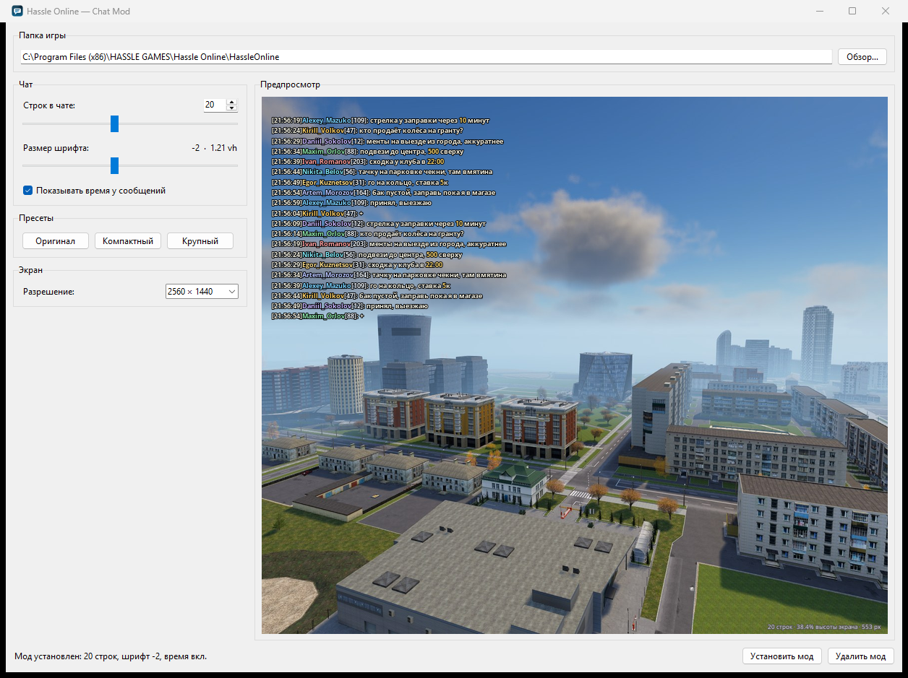

# Hassle Chat Mod


Неофициальная утилита для настройки чата в **Hassle Online**: сколько строк
показывать, какой размер шрифта и нужны ли метки времени. Работает локально,
без интернета и без вмешательства в серверную часть игры.

**Скачать:** [Releases](../../releases) → `HassleChatMod-Setup.exe`



---

## Что делает

1. Находит в установленной игре UI-пак и читает из него `assets/index.js`.
2. Меняет в нём три значения:
   - `chatPageSize` — количество строк чата;
   - `chatFontSize` — размер шрифта и межстрочного интервала;
   - `chatTimestamps` — время у сообщений.
3. Собирает `pakchunk999-Windows.pak` (+ пустые `.utoc` / `.ucas`) и кладёт его
   в `…\Hassle Online\HassleOnline\Content\Paks\`.
4. Показывает предпросмотр поверх реального скриншота игры с настоящим
   игровым шрифтом `Hassle Open Sans`.

При обновлении игры мод пересобирается заново из актуального `index.js`,
поэтому ничего не ломается.

## Установка

1. Скачай `HassleChatMod-Setup.exe` из [Releases](../../releases).
2. Запусти, нажми «Установить» (права администратора не нужны — установка
   в профиль пользователя).
3. Запусти игру, открой приложение, выставь строки/шрифт, нажми
   «Установить мод».
4. Полностью перезапусти игру.

Удаление — через «Установка и удаление программ» или кнопку «Удалить»
в установщике.

## Как это работает технически

- Мод — это обычный **pak-файл Unreal Engine** с одним переопределённым
  файлом `UserInterface/Main/assets/index.js`. Игра монтирует его поверх
  штатного UI.
- Пак собирается библиотекой [repak](https://github.com/trumank/repak)
  с теми же параметрами (`mount point`, версия пака и `path hash seed`),
  что использует сама игра.
- Никаких инъекций в процесс, хуков, чтения памяти и сетевых запросов.
  Приложение просто читает и записывает файлы.
- Серверная логика не затрагивается: меняется только отрисовка чата
  на клиенте.

## Сборка из исходников

```powershell
py -m pip install -r requirements.txt

# приложение
py -m PyInstaller --noconfirm --onefile --windowed --name HassleChatMod ^
    --icon icon.ico --add-data "preview.jpg;." --add-data "fonts;fonts" ^
    --add-data "icon.ico;." --collect-all repak hassle_chat_mod.py

# установщик
py -m PyInstaller --noconfirm --onefile --windowed --name HassleChatMod-Setup ^
    --icon icon.ico --add-data "dist/HassleChatMod.exe;payload" ^
    --add-data "icon.ico;." --add-data "icon.png;." ^
    --add-data "README.md;payload" --add-data "LICENSE;payload" setup.py
```

Готовые файлы — в `dist/`.

## Приватность

- Нет сети, телеметрии, автообновлений и аналитики.
- Настройки хранятся в `%APPDATA%\HassleChatMod\config.json`.
- Иконка и шрифт берутся из ресурсов приложения.

## Дисклеймер

Проект не связан с Hassle Games / Hassle Online. Это пользовательская
утилита для настройки интерфейса. Используй на свой страх и риск;
перед установкой мода закрой игру.
Шрифт `Hassle Open Sans` — производная Open Sans (SIL Open Font License),
файлы лежат в `fonts/` и используются только для предпросмотра.

## Лицензия

[MIT](LICENSE)
